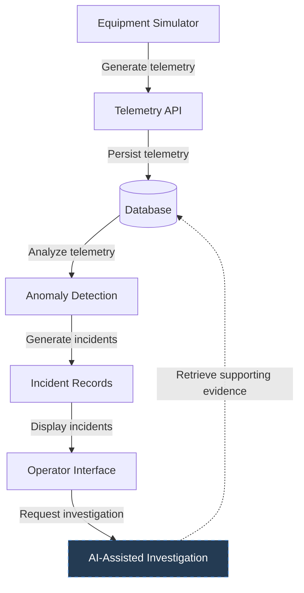

# Industrial Operations Intelligence Platform (IOIP)

An industrial equipment monitoring and incident investigation platform
demonstrating modern software engineering, data processing, anomaly
detection, and evidence-grounded AI workflows.

## Overview

The Industrial Operations Intelligence Platform (IOIP) is a
portfolio application that simulates an industrial environment
where equipment continuously generates operational telemetry.

The platform ingests and stores telemetry, identifies abnormal
equipment behavior, and supports investigation of operational
incidents.

As the project develops, IOIP will incorporate AI-assisted
investigation capabilities to help operators understand
equipment failures, evaluate potential causes, and make
informed operational decisions.

The application is designed to demonstrate practical
engineering techniques used in modern industrial software
systems, including backend development, data architecture,
asynchronous processing, observability, testing, and
AI integration.

## Project Objectives

IOIP has four primary objectives:

1. Build a reliable, maintainable, end-to-end software application.
2. Demonstrate engineering competence across backend systems,
   databases, APIs, and frontend development.
3. Implement practical AI engineering techniques, including
   retrieval, grounding, structured outputs, and evaluation.
4. Develop a portfolio project that demonstrates the ability
   to design, implement, debug, and explain complex systems.

The emphasis is on engineering quality and technical depth
rather than feature count.

## System Concept

IOIP simulates a facility containing industrial equipment
such as pumps, motors, compressors, and other machinery.

Equipment produces telemetry including:

- Temperature
- Pressure
- Vibration
- Rotational speed
- Power consumption
- Operating status

Telemetry is ingested into the platform and stored for
historical analysis.

Anomaly detection identifies unusual operating conditions
and generates incidents for investigation.

Operators can review incidents, inspect supporting telemetry,
and eventually request AI-assisted investigations.

AI-generated investigations will distinguish observed
evidence from possible explanations and preserve references
to the underlying data.

Human operators retain responsibility for operational decisions.

## Planned Architecture

The initial architecture will favor simplicity and local
development.

Potential components include:

| Component | Technology |
|-----------|------------|
| Backend API | Python / FastAPI |
| Database | PostgreSQL |
| Frontend | React / TypeScript |
| Telemetry Simulator | Python |
| Anomaly Detection | Python |
| AI Investigation | LLM API integration |
| Containerization | Docker |
| Testing | pytest and frontend testing tools |

These technologies are initial candidates and may change
based on implementation requirements.

### Conceptual Data Flow

### Conceptual Data Flow

The architecture will evolve incrementally as components
are implemented and tested.

## Development Roadmap

### Phase 1: Core Telemetry Pipeline

Establish the first working end-to-end system.

- Create the backend application
- Implement an equipment telemetry simulator
- Create telemetry ingestion endpoints
- Persist telemetry in a database
- Retrieve telemetry through the API
- Add initial automated tests

### Phase 2: Anomaly Detection

Introduce operational intelligence.

- Implement deterministic anomaly detection
- Define incident generation rules
- Persist incidents and their supporting evidence
- Support incident lifecycle management

### Phase 3: Operator Interface

Develop a usable operational dashboard.

- Display equipment and operating conditions
- Visualize historical telemetry
- Display active and historical incidents
- Support incident review and acknowledgment

### Phase 4: AI-Assisted Investigation

Introduce evidence-grounded AI capabilities.

- Retrieve relevant operational history
- Assemble investigation context
- Generate structured incident investigations
- Distinguish observations from hypotheses
- Preserve evidence provenance
- Evaluate investigation quality and reliability

### Phase 5: Production Engineering

Improve system reliability and deployment readiness.

- Expand automated testing
- Introduce structured logging and observability
- Evaluate performance and failure scenarios
- Implement CI/CD
- Deploy a publicly accessible demonstration

These phases describe planned work, not completed functionality.

See [ROADMAP.md](ROADMAP.md) for detailed milestones.

## Current Status

**Status:** Initial project setup

The repository and initial documentation structure have
been created.

Application development has not yet begun.

The first development milestone is a working telemetry
pipeline connecting simulation, API ingestion, persistence,
and retrieval.

## Getting Started

Development environment setup instructions will be added
once the initial application structure is implemented.

The application is not yet runnable.

## Engineering Principles

The project follows several guiding principles:

- Build working software incrementally.
- Prefer simple solutions over unnecessary complexity.
- Write readable, maintainable, testable code.
- Validate assumptions through experiments and tests.
- Treat debugging as a core engineering activity.
- Preserve data integrity and evidence provenance.
- Use AI only where it provides meaningful value.
- Require human approval for consequential actions.
- Document significant architectural decisions.

## Project Documentation

| Document | Purpose |
|----------|---------|
| [README.md](README.md) | Project overview and setup |
| [ARCHITECTURE.md](ARCHITECTURE.md) | System architecture and components |
| [ROADMAP.md](ROADMAP.md) | Milestones and development progress |
| [DECISIONS.md](DECISIONS.md) | Architectural decisions and tradeoffs |
| [DEVLOG.md](DEVLOG.md) | Development history and lessons learned |

## Project Scope

IOIP is a simulated industrial operations platform.

It is not intended for controlling real industrial equipment
or making autonomous operational decisions.

All simulated equipment, telemetry, incidents, and
investigations are for development and demonstration purposes.

## License

No license has been selected.